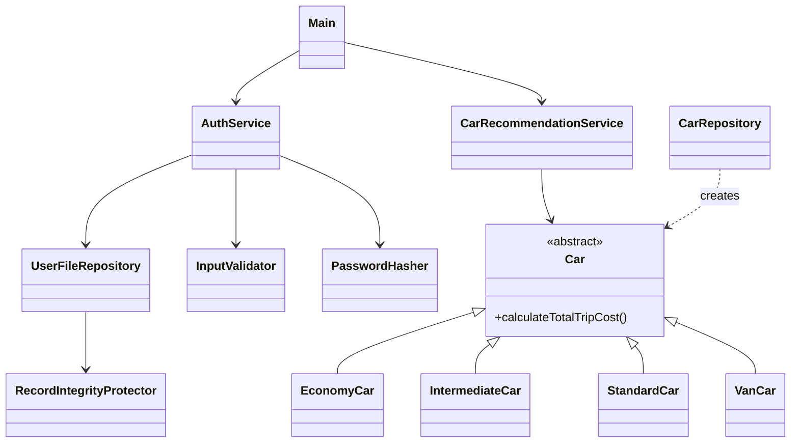

# 🚗 Secure Car Rental Recommendation System

A **Java console application** that recommends the cheapest suitable rental car for a trip,
built around **secure coding practices**: input validation, hashed passwords, tamper-evident user
records and safe error messages.


## How it works

1. **Sign up / sign in** with a username and password.
2. Enter the **number of passengers**, **rental days** and **approximate trip mileage**.
3. The app filters the cars that fit your group, computes the **total trip cost**
   (rental + fuel), and recommends the cheapest option — preferring the more comfortable car on a tie.

```text
total cost = rental cost per day × days  +  (trip miles ÷ miles per gallon) × gas price ($2.25/gal)
```

| Tier | Rental / day | Max passengers | Comfort |
| --- | --- | --- | --- |
| Economy | $45 | 4 | Poor |
| Intermediate | $50 | 4 | Medium |
| Standard | $55 | 5 | Good |
| Van | $70 | 7 | Medium |

The fleet covers coupe, sedan, hybrid, truck, crossover, SUV and minivan categories
(Ford Mustang, Honda Accord, Toyota Prius, Ford F-150, Subaru Outback, Toyota RAV4, Honda Odyssey).

## Example session

Signing in and asking for **4 passengers · 5 days · 300 miles**:

```text
============================================
   Secure Car Rental Recommendation System
============================================
Gas price used for calculation: $2.25/gallon

Select an option:
1. Sign Up
2. Sign In
3. Exit
Enter your choice: 2
Username: demo_user
Password:
Welcome, demo_user!

Enter number of passengers: 4
Enter number of rental days: 5
Enter approximate trip mileage: 300

===== Recommended Cars =====

Car: Ford Mustang
   Category: COUPE
   Tier: ECONOMY (POOR)
   Passengers: 4
   Total Cost: $250.96
----------------------------------
```

For **7 passengers · 3 days · 900 miles** only the van fits, so the result is the **Honda Odyssey ($302.05)**.
(Output above was captured from a real run.)

## Run it

You only need a **JDK 17 or newer** (developed with Java 21).

```bash
# macOS / Linux
sh run.sh

# Windows
run.bat
```

Or manually:

```bash
javac -encoding UTF-8 -d out $(find src -name "*.java")
java -cp out com.cccy225.carrental.app.Main
```

User accounts are stored in `data/users.txt`, created automatically on first sign-up (git-ignored).

## Security design

| Practice | Where |
| --- | --- |
| **Input validation** – username 3–20 chars `[A-Za-z0-9_]`, password ≥ 8 chars, passengers 1–7, days 1–365, miles up to 100 000 | `InputValidator` |
| **Password hashing** – passwords are never stored in clear text (SHA-256) | `PasswordHasher` |
| **Tamper-evident records** – every stored user line carries a checksum; a modified file is rejected | `RecordIntegrityProtector`, `UserFileRepository` |
| **Safe error messages** – internal exceptions are never leaked to the user | `SecureErrorHandler` |
| **Generic login failure** – same message for unknown user and wrong password (no user enumeration) | `AuthService` |

> **Production note:** this is an educational project. A real system should replace plain SHA-256 with a
> salted, slow password hash (bcrypt, scrypt, Argon2 or PBKDF2) and store users in a database.

## Architecture



## Project structure

```text
src/com/cccy225/carrental/
├── app/          Main – console flow
├── auth/         User
├── model/        Car hierarchy, RentalTier, ComfortLevel, TripRequest, RecommendationResult
├── persistence/  UserFileRepository (file storage with integrity checks)
├── repository/   CarRepository (available fleet)
├── security/     InputValidator, PasswordHasher, RecordIntegrityProtector, SecureErrorHandler
├── service/      AuthService, CarRecommendationService
└── util/         ConsolePrinter
test/             JUnit 5 tests for auth, recommendations, repository, validation and hashing
```

## Tests

The `test/` folder contains **JUnit 5** tests (`AuthServiceTest`, `CarRecommendationServiceTest`,
`CarRepositoryTest`, `InputValidatorTest`, `PasswordHasherTest`, `RecordIntegrityProtectorTest`).
Run them from Eclipse or IntelliJ (the project includes an Eclipse `.classpath` with JUnit 5), or with the
[JUnit Console Launcher](https://junit.org/junit5/docs/current/user-guide/#running-tests-console-launcher).
